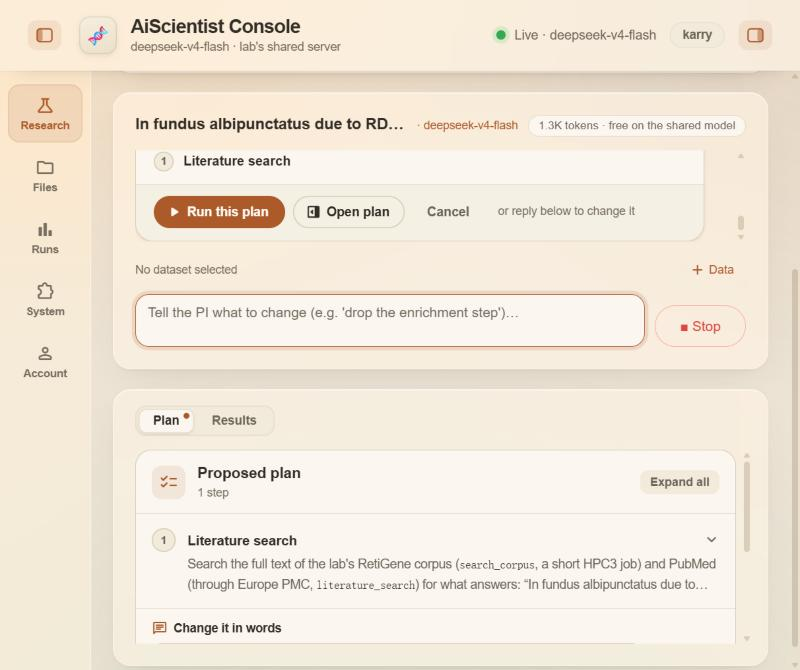

# Issue #35 — one literature question end to end: RetiGene corpus + PubMed

Report for [RCHENLAB/AiScientist#35](https://github.com/RCHENLAB/AiScientist/issues/35).
One question, one complete run, on https://AiScientist.eye.som.uci.edu.

**Result: pass.** The plan card named the RetiGene corpus and PubMed, the corpus search ran on HPC3 and returned 12 passages, and the answer is correct against the reference answer.

## 1. Setup

| | |
|---|---|
| Account | `karry` (HPC3 user `zianx11`) |
| Session | connected to HPC3 (`zianx11 @ hpc3`) |
| Model | `deepseek-v4-flash`, shared model on HPC3 |
| Date and time | 2026-10-21, question sent 20:39:14 PDT |
| Chat / run | conversation 160, run `934cae4567b8` |

## 2. Timing

| Interval | Time |
|---|---|
| Sending the question → plan card | about 3 s (sent 20:39:14.7, plan card shown 20:39:17.4) |
| Pressing Run → complete answer | about 75 s (Run 20:39:43.2, answer saved 20:40:57.9) |

The start times are clock readings taken in the browser. The answer time is the server timestamp of the answer message.

## 3. The plan card



One step, *Literature search*:

> Search the full text of the lab's RetiGene corpus (`search_corpus`, a short HPC3 job) and PubMed (through Europe PMC, `literature_search`) for what answers: "In fundus albipunctatus due to RDH5 mutations, how does the rod ERG change after an extended period of dark adaptation?". Read the best corpus passages (up to 12) and the abstracts of the most relevant PubMed papers (up to 12), and answer with numbered citations to them. It takes one to a few minutes.

## 4. The answer (copied from the chat)

In fundus albipunctatus due to RDH5 mutations, the rod ERG—severely reduced or nonrecordable after standard dark adaptation—usually recovers to normal or near-normal amplitudes after extended dark adaptation (typically 2–3 hours), although recovery can be incomplete in some patients, especially those with coexisting macular or cone dystrophy [2, 3, 4, 5].

After a short dark-adaptation period (e.g., 20–30 minutes), rod-specific b-waves are markedly reduced or absent, and bright-flash ERGs may have a "negative" configuration [3, 5]. When dark adaptation is prolonged to 2–3 hours, most patients without macular dystrophy show normalization of the rod b-wave and single-flash ERG responses [3]. A case series reported that dim-flash rod ERGs normalized after prolonged dark adaptation in 7 of 9 patients, with incomplete recovery in 2 [2]. Similarly, a patient with macular degeneration showed scotopic ERGs that were significantly reduced after 20 minutes but recovered after 2 hours of dark adaptation [4], and a child with macular dystrophy had no scotopic ERG after 20 minutes but normal responses after 3 hours [5].

However, recovery is not universal. In patients with RDH5-associated macular dystrophy, the degree of rod ERG improvement after prolonged dark adaptation varies: some recover fully, while others show little or no improvement, suggesting additional rod degeneration [3]. Thus, the typical response to extended dark adaptation is substantial recovery of the rod ERG, but incomplete recovery identifies a subset with more severe retinal dysfunction.

References
- [2] Sergouniotis PI et al. Phenotypic variability in RDH5 retinopathy (Fundus Albipunctatus). Ophthalmology (2011). PMID:21529959 DOI:10.1016/j.ophtha.2010.12.031 https://pubmed.ncbi.nlm.nih.gov/21529959/
- [3] Nakamura M et al. RDH5 gene mutations and electroretinogram in fundus albipunctatus with or without macular dystrophy: RDH5 mutations and ERG in fundus albipunctatus. Doc Ophthalmol (2003). PMID:12906118 DOI:10.1023/a:1024498826904 https://pubmed.ncbi.nlm.nih.gov/12906118/
- [4] Hotta K et al. Macular dystrophy in a Japanese family with fundus albipunctatus. Am J Ophthalmol (2003). PMID:12788147 DOI:10.1016/s0002-9394(02)02290-0 https://pubmed.ncbi.nlm.nih.gov/12788147/
- [5] Nakamura M et al. Macular dystrophy in a 9-year-old boy with fundus albipunctatus. Am J Ophthalmol (2002). PMID:11812441 DOI:10.1016/s0002-9394(01)01304-6 https://pubmed.ncbi.nlm.nih.gov/11812441/

## 5. Sources

10 papers were read: 5 from the corpus (12 passages) and 5 more from PubMed. No paper came from both.

| PMID | Paper | Read (`papers.csv`) | Cited in the answer | Corpus passages |
|---|---|---|---|---|
| 11812441 | Nakamura 2002, Am J Ophthalmol | yes, corpus | yes [5] | 2 |
| 12788147 | Hotta 2003, Am J Ophthalmol | yes, corpus | yes [4] | 2 |
| 12906118 | Nakamura 2003, Doc Ophthalmol | yes, corpus | yes [3] | 3 |
| 15790919 | Niwa 2005, IOVS | yes, corpus | no (source [1]) | 2 |
| 21529959 | Sergouniotis 2011, Ophthalmology | yes, corpus | yes [2] | 3 |
| 35433063 | You 2022, Case Rep Genet | **no** | no | 0 |

- **Reference PMIDs read:** 5 of 6. You H et al. (2022) was not among the sources.
- **Reference PMIDs cited:** 4 of 6 (21529959, 12906118, 12788147, 11812441).
- **Corpus passages:** 12 read, 10 of which state the answer. The 2 that do not are both from Niwa 2005: one is about cone dysfunction plus the reference list, and the other is the methods text for the 3-hour rod ERG, which gives no result. The issue's offline check found 9 of 12.
- **PubMed papers (5, none cited):** PMIDs 42554417, 42447353, 42065837, 41902999 and 42444145. All are from 2026, and none of them is one of the reference papers (see Problems).

## 6. Correctness against the reference answer

**Correct.** The answer says the rod ERG is markedly reduced or nonrecordable after standard dark adaptation, recovers to normal or near normal after hours of dark adaptation, and that recovery varies, with little or none in some patients who have macular or cone dystrophy. That covers every point of the reference answer.

## 7. Activity log (copied from *Thinking & activity*)

```
→ literature_search({"query": "RDH5 dark adaptation"})
→ search_corpus({"queries": ["In fundus albipunctatus due to RDH5 mutations, how does the rod ERG change after an extended period of dark adaptation?"], "top_k": 12, "terms": ["RDH5", "fundus albipunctatus", "rod ERG)
✓ literature_search: 1 paper(s)
→ literature_search({"query": "fundus albipunctatus ERG"})
✓ literature_search: 4 paper(s)
→ literature_search({"query": "RDH5 rod ERG"})
✓ literature_search: 1 paper(s)
→ literature_search({"query": "fundus albipunctatus electroretinogram"})
✓ literature_search: 1 paper(s)
✓ search_corpus: 12 passage(s)
```

Chat status line: `📄 10 paper(s), 5 from the RetiGene corpus (12 passage(s)) and 5 more from PubMed — reading them and writing the answer.`

Corpus words with passage counts, from `summary.md`: RDH5 (116), fundus (3084), albipunctatus (120), due (3682), mutations (19799), rod (2682), erg (2677), change (5727), extended (2778), period (799), dark (897), adaptation (498), fundus albipunctatus (118), rod ERG (113), electroretinogram (1854), dark adaptation (358).

## 8. Problems

There were no errors or warnings, and the corpus search did not fall back to PubMed. Points worth a look:

1. **PubMed adds little.** The 4 queries returned 1, 4, 1 and 1 hits, 7 hits for 5 distinct papers. All of them are from 2026, and none is a classic fundus albipunctatus ERG paper. A query as plain as "fundus albipunctatus ERG" returning only 4 recent papers suggests the Europe PMC search is sorted by date or filtered too tightly. Without the corpus, this answer would have had no relevant source.
2. **One reference paper missing:** PMID 35433063 (You 2022) was not retrieved by the corpus or by PubMed.
3. **Activity log cuts off the `search_corpus` call** in the middle of the `terms` list (`"rod ERG)`), so the log does not show the model's full word list. The words do appear in `summary.md`.
4. **Reference numbering starts at [2].** The uncited source [1] (Niwa 2005) is left out of the reference list, so a reader sees a list that begins at [2]. This is consistent with "code writes the reference list", but it looks like a gap.
5. **`papers.csv` corpus rows have empty `authors`, `year`, `journal` and `doi` columns.** That information is only inside the `title` string. PubMed rows fill those columns.
6. **The question's own words include filler words** such as `due` (3682 passages), `change`, `extended` and `period` in the BM25 word list. They did not hurt this run, but they carry little weight.
7. **UI while the plan waited for approval:** the chat showed "Working… · 15s" and an active **Stop** button although nothing was running. After Run, the elapsed timer counted from when the question was sent, not from Run.

## 9. Attachments

- [`summary.md`](summary.md) (`report/summary.md`)
- [`papers.csv`](papers.csv) (`literature/papers.csv`)
- [`corpus_passages.md`](corpus_passages.md) (`literature/corpus_passages.md`)
- [`plan_card.jpg`](plan_card.jpg)

The files are byte-for-byte as downloaded from the run's zip bundle (`aiscientist_results_934cae4567b8.zip`).
